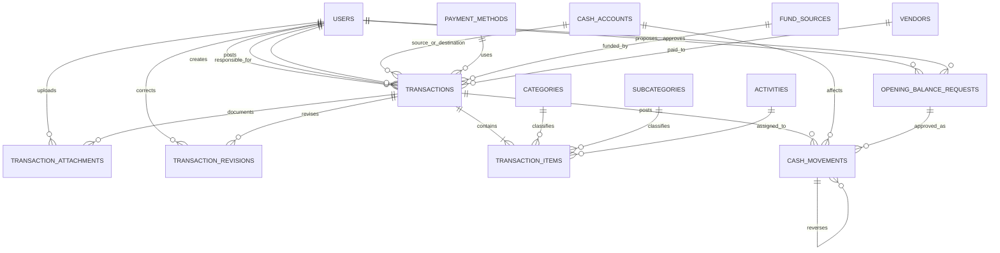

# SpendCheck Phase 3A — Rancangan Final

Status: **Rancangan untuk review; belum diimplementasikan.**

Dokumen ini menggabungkan batas Phase 3A dan keputusan kebijakan final. Rancangan database dan alur teknis adalah rekomendasi implementasi; keputusan organisasi yang belum diberikan ditandai **Terbuka** dan tidak dianggap sebagai kebijakan.

## 1. Keputusan kebijakan final

- `divisi_keuangan` hanya dapat melihat dan memeriksa transaksi. Tidak memiliki izin membuat, mengubah, mem-posting, atau mengoreksi transaksi.
- Hanya `keuangan_sarpras` yang dapat mem-posting transaksi.
- `admin_system` tidak otomatis memiliki kewenangan finansial atau persetujuan keuangan.
- `petugas_sarpras` hanya dapat membuat draft pengeluaran sesuai batas akses yang disetujui Phase 2. Tidak dapat mem-posting.
- Saldo awal diusulkan oleh `keuangan_sarpras`; `kepala_sarpras` memeriksa dan menyetujui. Movement saldo awal baru memengaruhi saldo setelah persetujuan.
- Saldo akun bersumber hanya dari `cash_movements`. Tidak ada saldo yang diedit langsung pada akun.
- Transaksi posted tidak dapat diedit atau dihapus langsung. Koreksi memakai reversal dan replacement yang mempertahankan histori serta audit trail.
- Transfer internal bukan pemasukan maupun pengeluaran operasional.
- Pencairan bon adalah pengeluaran kas/movement keluar, tetapi bukan otomatis biaya final. Fitur bon tetap di luar Phase 3A.
- Reimbursement belum dibayar bukan movement keluar; saat dibayar barulah menghasilkan movement keluar. Fitur reimbursement tetap di luar Phase 3A.

## 2. Audit baseline Phase 1/2

Repository terakhir diaudit berada di branch `main`, commit `dc80d98`, dengan working tree bersih. Phase 2 memiliki master kategori, subkategori, kegiatan, vendor, akun kas, sumber dana, dan metode pembayaran. `cash_accounts` belum mempunyai kolom saldo.

Role dan permission menggunakan `roles`, `permissions`, `role_user`, dan `permission_role`; Gate di `AppServiceProvider` membaca permission melalui `User::hasPermission()`. Tidak ditemukan direktori Policy khusus. Audit log append-only tersedia melalui `AuditLogger`, dengan subject polymorphic, nilai lama/baru, pengguna, IP, dan user agent. Test memakai SQLite in-memory dari konfigurasi PHPUnit.

Belum ada model atau tabel transaksi/cash movement di baseline. Phase 3A harus menjaga pola Gate, Form Request, service, Blade, AuditLogger dan test yang sudah digunakan.

## 3. ERD usulan

`opening_balance_requests` ditambahkan terpisah karena saldo awal memiliki pemohon, pemeriksa/persetujuan, dan lifecycle yang berbeda dari transaksi biasa. Hanya record berstatus approved menghasilkan cash movement. Cash movement saldo awal tetap mengarah ke akun dan menjadi sumber saldo yang sama.

## 4. Struktur tabel yang direkomendasikan

Semua tabel memakai PK bigint, timestamps jika sesuai, FK dengan `RESTRICT` untuk histori yang dirujuk, serta index sesuai filter/listing. Nilai uang **DECIMAL(19,2)**, tidak pernah float. Kuantitas **DECIMAL(18,4)**. Backend menghitung semua subtotal dan total.

### `transactions`

- `id`, `number` unik, `type` (`income`, `expense`, `transfer`, extensible untuk tipe masa depan), `occurred_at`, `description`.
- `responsible_user_id`, `created_by`, `payment_method_id`.
- `source_cash_account_id` dan `destination_cash_account_id` nullable, diwajibkan sesuai tipe.
- `vendor_id`, `fund_source_id` nullable sesuai aturan tipe transaksi.
- `status` (`draft`, `pending_approval` hanya jika workflow kelak memerlukannya, `posted`, `reversed`, `rejected`, `void`); jangan menambah state approval transaksi umum sebelum kebijakannya diputuskan.
- `total_amount DECIMAL(19,2)` sebagai nilai snapshot hasil hitung backend; `notes`, `posted_by`, `posted_at`, `reversal_of_id` nullable.
- Index `(type, occurred_at)`, `(status, occurred_at)`, FK yang difilter, dan unique `number`.

### `transaction_items`

- `id`, `transaction_id`, `description`, `category_id`, `subcategory_id` nullable, `activity_id` nullable.
- `quantity DECIMAL(18,4)`, `unit`, `unit_price DECIMAL(19,2)`, `subtotal DECIMAL(19,2)`.
- FK kategori/subkategori/kegiatan memakai restrict. Validasi aplikasi memastikan subkategori milik kategori terpilih. Dapat diperkuat dengan composite FK `(category_id, subcategory_id)` setelah diverifikasi terhadap dukungan MySQL dan desain key.
- Income perlu item juga, atau satu baris item nominal; jangan percaya jumlah total yang dikirim browser.

### `cash_movements`

- `id`, `cash_account_id`, `transaction_id` nullable untuk opening balance, `opening_balance_request_id` nullable.
- `kind` (`income`, `expense`, `transfer_in`, `transfer_out`, `opening_balance`, `reversal`), `direction` (`in`, `out`), `amount DECIMAL(19,2)` positif.
- `idempotency_key` unik per movement, `occurred_at` (tanggal efektif), `recorded_at`, `created_by`, `reversal_of_id` nullable.
- Index `(cash_account_id, occurred_at, id)`, `transaction_id`, dan FK referensi.
- Untuk transfer, catat dua row: `transfer_out/out` dan `transfer_in/in`, dengan referensi transaksi sama dan nominal identik. Unique constraint tambahan atas sumber posting perlu mencegah pasangan terduplikasi.

### `transaction_attachments`

- `id`, `transaction_id`, `original_name`, `storage_disk`, `path` unik, `mime_type`, `size_bytes`, `checksum` nullable, `uploaded_by`, timestamps.
- File disimpan privat dengan nama buatan server. Validasi MIME berdasarkan konten, ukuran, dan otorisasi download; jangan simpan path publik terbuka.

### `transaction_revisions`

- `id`, `transaction_id`, `revision_number`, `before_values JSON`, `after_values JSON`, `reason`, `corrected_by`, `created_at`.
- Unique `(transaction_id, revision_number)`. Revision append-only.

### `opening_balance_requests`

- `id`, `cash_account_id`, `amount DECIMAL(19,2)` positif, `effective_at`, `reason`, `status` (`pending`, `approved`, `rejected`, `cancelled`).
- `proposed_by`, `proposed_at`, `reviewed_by`, `reviewed_at`, `review_notes`, timestamps.
- Satu movement `opening_balance/in` dibuat atomik saat status berubah menjadi approved. Uniqueness pada movement/request memastikan persetujuan tidak menggandakan saldo.
- Usulan ini memerlukan permission khusus `cash_accounts.opening_balance.propose` dan `cash_accounts.opening_balance.approve`.

## 5. Workflow konsisten

### Income

1. Pengguna berizin membuat draft dengan akun tujuan aktif, tanggal, metode, penanggung jawab, sumber dana bila relevan, dan item nominal.
2. Backend memvalidasi master aktif, menghitung item dan total menggunakan aritmetika decimal.
3. Hanya `keuangan_sarpras` dapat posting. Di dalam DB transaction, lock transaksi dan akun tujuan, verifikasi masih draft/belum posted, catat actor/waktu dan satu movement `income/in` dengan idempotency key, kemudian tandai posted.
4. Semua perubahan commit bersama. Kegagalan me-rollback semuanya.

### Expense

1. `petugas_sarpras` hanya membuat draft pengeluaran dalam batas aksesnya; `keuangan_sarpras` dapat membuat draft sesuai permission final.
2. Draft berisi akun sumber, penanggung jawab, metode, vendor/sumber dana bila relevan, item kategori/subkategori/kegiatan, dan lampiran privat.
3. Server memvalidasi relasi dan menghitung subtotal/total. Jangan mempercayai total dari client.
4. `keuangan_sarpras` mem-posting secara atomik satu movement `expense/out` dan status posted.
5. Pencairan bon di masa depan dapat direpresentasikan sebagai pengeluaran kas tersendiri, tetapi pembebanan biaya final menunggu pertanggungjawaban; jangan menghitung pencairan sebagai biaya final otomatis.

### Transfer

1. Draft berisi akun asal dan tujuan aktif, tidak sama, jumlah, tanggal, dan deskripsi.
2. Saat posting, lock kedua akun berurutan berdasarkan ID untuk mengurangi deadlock.
3. Satu DB transaction menulis movement keluar dan masuk dengan jumlah identik, lalu status posted. Unique idempotency key mencegah pengulangan.
4. Kedua movement tampil pada cashflow masing-masing akun, tetapi dikecualikan dari income/expense operasional.

### Saldo awal

1. `keuangan_sarpras` mengajukan akun, nominal, tanggal efektif, alasan, dan bukti/referensi bila kebijakan meminta.
2. Request berstatus pending tidak memengaruhi saldo.
3. `kepala_sarpras` memeriksa dan menyetujui atau menolak. Pemohon tidak boleh menyetujui request sendiri sebagai kontrol teknis yang direkomendasikan.
4. Persetujuan dan pembuatan satu movement `opening_balance/in` berlangsung atomik. Persetujuan ulang tidak menghasilkan movement tambahan.
5. Koreksi saldo awal yang telah disetujui memakai reversal/correction workflow, tidak mengedit movement langsung.

### Koreksi dan periode final

1. Posted tidak boleh diubah/dihapus langsung.
2. Pemegang `transactions.correct` mengajukan alasan serta nilai replacement. Simpan before/after di revision append-only.
3. Dalam transaksi DB dengan lock, buat movement reversal untuk movement lama, transaksi replacement bernomor baru, movement replacement, dan audit log; tandai transaksi asli reversed. Jika satu langkah gagal, rollback semua.
4. Jangan menghapus movement lama: histori saldo tetap dapat direkonstruksi.
5. **Periode laporan final:** jangan menulis ulang atau mengubah angka periode yang sudah ditutup. Rekomendasi: koreksi harus diposting sebagai reversal dan replacement bertanggal pada periode terbuka saat ini, sambil menyimpan tanggal/nilai asli dan referensi periode asal. Pengaruh ke saldo berjalan tetap terlihat; laporan periode tertutup memakai snapshot/finalization yang immutable dan menampilkan koreksi kemudian sebagai penyesuaian periode berjalan.
6. Perlu keputusan bisnis: siapa yang membuka/menutup periode, definisi periode (bulanan/tahun fiskal), apakah koreksi lintas periode memerlukan persetujuan Kepala Sarpras/divisi lain, dan bagaimana laporan restatement ditampilkan. Sampai diputuskan, koreksi lintas periode harus ditahan untuk review manual, bukan mengasumsikan aturan.

## 6. Cashflow dan saldo rekening

Satu-satunya sumber saldo adalah `cash_movements`:

`saldo = SUM(amount arah masuk) - SUM(amount arah keluar)`

Termasuk movement opening balance yang telah approved dan movement reversal. Tidak ada cache saldo otoritatif atau kolom saldo akun yang dapat diedit. Jika agregat di-cache demi performa, ia hanya proyeksi yang dapat direbuild dari ledger dan bukan sumber kebenaran.

Cashflow menampilkan movement per akun serta saldo berjalan berdasarkan tanggal efektif dan ID sebagai tie-breaker. Ringkasan income/expense mengecualikan transfer, opening balance, dan reversal dari kategori operasional normal; reversal mengimbangi movement sebelumnya dan perlu klasifikasi yang tetap dapat diaudit. Transaksi bon di masa depan harus membedakan arus kas pencairan dari biaya final.

## 7. Permission dan matriks final Phase 3A yang diusulkan

Permission minimum:

- `transactions.view`
- `transactions.income.create`
- `transactions.expense.create`
- `transactions.transfer.create`
- `transactions.post`
- `transactions.correct`
- `cashflow.view`
- `cash_accounts.opening_balance.propose`
- `cash_accounts.opening_balance.approve`

Makna permission finansial final: posting hanya Keuangan Sarpras; Divisi Keuangan read-only; Petugas Sarpras hanya draft expense; Admin System tidak otomatis finansial. Matriks berikut menerapkan keputusan itu dan memisahkan usulan yang masih perlu review.

| Role | Lihat transaksi | Buat income draft | Buat expense draft | Buat transfer draft | Cashflow | Posting | Koreksi | Ajukan saldo awal | Setujui saldo awal |
|---|---:|---:|---:|---:|---:|---:|---:|---:|---:|
| `admin_system` | — | — | — | — | — | — | — | — | — |
| `petugas_sarpras` | Lihat* | — | Ya, terbatas | — | — | — | — | — | — |
| `driver` | — | — | — | — | — | — | — | — | — |
| `keuangan_sarpras` | Lihat | Ya | Ya | Ya | Lihat | Ya | Ya** | Ajukan | — |
| `kepala_sarpras` | Lihat | — | — | — | Lihat | — | — | — | Setujui |
| `divisi_keuangan` | Lihat dan periksa | — | — | — | Lihat | — | — | — | — |

- `*` Petugas Sarpras melihat transaksi yang dibuatnya atau unit yang menjadi tanggung jawabnya hanya jika scoping akses disepakati dan diterapkan. Tanpa kebijakan organisasi untuk unit scope, jangan menganggap akses global.
- `**` Koreksi berada pada `keuangan_sarpras` sebagai rekomendasi berdasarkan kewenangan posting. Perlu review apakah koreksi harus memerlukan persetujuan Kepala Sarpras. Persetujuan saldo awal Kepala Sarpras adalah final; jangan menganggap persetujuan itu otomatis berlaku untuk koreksi transaksi.
- `divisi_keuangan` tidak memperoleh permission write apa pun. “Memeriksa” berarti membaca detail, dokumen yang berhak diakses, dan histori/audit terkait; tidak mengubah status atau data.
- Implementasi Gate harus memeriksa permission backend pada seluruh route dan action. UI menyembunyikan aksi saja tidak cukup.

## 8. Rancangan UI/UX

- **Daftar transaksi:** nomor, tanggal, jenis, deskripsi, pihak bertanggung jawab, total Rupiah, status. Pencarian dan filter tanggal, kategori, kegiatan, penanggung jawab, akun, jenis, dan status; server-side pagination.
- **Form income:** tanggal, tujuan kas, sumber dana bila perlu, metode, penanggung jawab, item nominal; simpan draft.
- **Form expense:** sumber kas, vendor, metode, penanggung jawab, item berulang (kategori, subkategori, kegiatan, kuantitas, satuan, harga), bukti nota; hanya aksi yang diizinkan role.
- **Form transfer:** akun sumber/tujuan, nominal, tanggal, deskripsi; larang akun sama; beri keterangan transfer internal bukan income/expense.
- **Detail transaksi:** status, pembuat, penanggung jawab, poster/timestamp, item, akun, total, file privat, movements, revision/reversal. Posted hanya memiliki aksi koreksi sesuai permission, tidak ada edit/delete.
- **Cashflow akun:** saldo hasil ledger, filter rentang dan jenis movement, saldo berjalan; opening balance ditandai approved dan sumber persetujuannya.
- **Histori koreksi:** nilai sebelum/sesudah, alasan, aktor, waktu, reversal dan replacement, periode asal serta periode pencatatan koreksi.
- **Saldo awal:** daftar pending/approved/rejected; form usulan Keuangan Sarpras dan layar pemeriksaan/persetujuan Kepala Sarpras.
- Nominal diformat Rupiah pada UI, dikirim sebagai string decimal/angka integer rupiah yang disepakati; file tidak diekspos lewat URL publik.

## 9. Daftar Feature Test

1. Role/permission: 403 untuk create/post/correct oleh Admin System, Driver, Kepala, Divisi Keuangan, dan Petugas yang tidak diizinkan; Divisi hanya read/check; Keuangan dapat post; Petugas hanya expense draft.
2. Scope Petugas: tidak dapat melihat/mengubah draft pengguna/unit lain bila scoping ditetapkan.
3. Create draft income/expense/transfer; master nonaktif dan relasi subkategori-kategori tidak valid ditolak.
4. Nominal nol/negatif, presisi/overflow tidak valid; nilai total manipulasi client diabaikan.
5. Subtotal item dan total transaksi dihitung server-side dengan decimal arithmetic.
6. Posting income membuat tepat satu movement masuk; expense tepat satu movement keluar.
7. Posting status/aktor/waktu dan audit log konsisten; draft tidak memengaruhi saldo.
8. Saldo dihitung hanya dari ledger, termasuk opening balance approved dan reversal.
9. Transfer akun sama ditolak; dua movement atomik; kegagalan salah satu menyebabkan rollback; transfer tidak mengubah total operasional income/expense.
10. Pengulangan request/posting tidak menggandakan transaksi atau movement.
11. Posted tidak dapat diedit/dihapus langsung; endpoint mengembalikan status penolakan yang konsisten.
12. Saldo awal pending/rejected tidak mengubah saldo; approval Kepala membuat tepat satu movement; non-Kepala ditolak; pemohon sendiri tidak dapat menyetujui jika aturan kontrol diri disetujui.
13. Attachment memvalidasi MIME, ukuran, authorization upload/download, path privat, dan metadata audit.
14. Koreksi memerlukan alasan, membuat revision, reversal, replacement, dan audit; histori lama tetap utuh.
15. Periode final tidak berubah oleh koreksi; koreksi ditanggal efektif sesuai kebijakan periode; perubahan melewati periode tertutup ditolak/ditahan sesuai keputusan yang disetujui.
16. Regressi seluruh feature test Phase 1/2.
17. Test menggunakan SQLite in-memory terpisah; locking/concurrency wajib tambahan pada MySQL CI karena SQLite tidak membuktikan semantik row lock MySQL.

## 10. Pembagian subfase

1. **Phase 3A.1 — Domain dan ledger:** tabel/domain transaksi, item, movements, saldo awal-request, nomor unik, saldo ledger, posting atomik/idempotent.
2. **Phase 3A.2 — Pemasukan dan pengeluaran:** draft, validasi master, perhitungan, vendor, lampiran privat, posting hanya Keuangan Sarpras; expense draft Petugas sesuai scope.
3. **Phase 3A.3 — Transfer dan cashflow:** pasangan movement transfer atomik, saldo akun, cashflow dan filter.
4. **Phase 3A.4 — Koreksi dan audit:** reversal/replacement, histori immutable, periode final, koreksi lintas periode sesuai persetujuan.
5. **Phase 3A.5 — Hardening dan regression testing:** matriks permission, scoping, concurrency MySQL, keamanan attachment, audit dan regresi Phase 1/2.

## 11. Keputusan teknis/organisasi yang masih terbuka

### Perlu persetujuan kebijakan

- Apakah koreksi transaksi posted memerlukan approval Kepala Sarpras sebelum reversal/replacement diposting.
- Definisi periode laporan, penutupan/finalisasi, pemilik fungsi close/reopen, serta perlakuan laporan dan koreksi lintas periode.
- Scope data Petugas Sarpras: transaksi pribadi, unit kerja, atau seluruh draft; keputusan ini menentukan authorization dan query scoping.
- Apakah Kepala Sarpras dan Divisi Keuangan boleh melihat seluruh lampiran atau ada batas akses dokumen.
- Aturan saldo negatif/overdraft, limit transaksi, dan approval berjenjang berdasarkan nominal.
- Apakah income harus selalu memiliki item, atau boleh satu nominal tanpa rincian.
- Siapa yang mengotorisasi/menginput saldo awal jika Keuangan Sarpras mengajukan dan Kepala menyetujui; siapa pengganti approver saat Kepala menjadi pemohon.
- Apakah `keuangan_sarpras` boleh mengoreksi transaksi yang dibuatnya sendiri, atau perlu separation of duties.

### Rekomendasi teknis, bukan kebijakan

- Gunakan transaksi DB, row lock, idempotency key, FK restrict, unique number, movement ledger append-only, file privat, checksum, dan decimal arithmetic.
- Hindari saldo terdenormalisasi sebagai sumber kebenaran; cache hanya proyeksi yang dapat dibangun ulang.
- Pencatatan replacement untuk koreksi lintas periode dilakukan pada periode terbuka dan tidak menulis ulang periode final; implementasi perlu menunggu keputusan definisi periode.

## 12. Batas implementasi

Dokumen ini hanya rancangan. Tidak ada migration, model, controller, service, request, middleware, route, view, frontend, seeder, database, `.env`, commit, atau push yang diubah/dijalankan. Implementasi Phase 3A menunggu instruksi persetujuan terpisah dan penyelesaian keputusan terbuka yang berdampak pada aturan bisnis.
