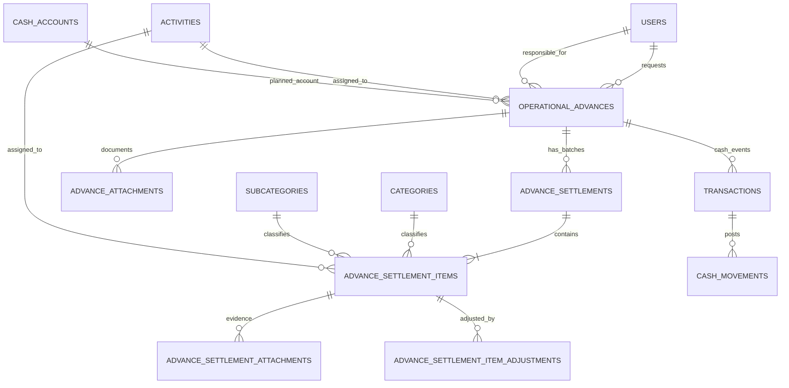

# SpendCheck Phase 3B — Bon Operasional dan Pertanggungjawaban Dana

Status: **Rancangan revisi untuk persetujuan; belum diimplementasikan.**

Dokumen ini merevisi rancangan awal berdasarkan keputusan bisnis terbaru dan review teknis. Phase 3B tetap memakai ledger Phase 3A; tidak membuat ledger kas kedua.

## 1. Keputusan bisnis yang sudah dikunci

1. **Keuangan Sarpras menyetujui sekaligus mencairkan bon.** Tidak diperlukan persetujuan Kepala Sarpras. Persetujuan dan pencairan merupakan dua aksi tercatat yang dilakukan Keuangan Sarpras.
2. **Pencairan satu kali penuh per bon.** Tidak ada pencairan bertahap. Nilai pencairan harus sama dengan nominal yang disetujui.
3. **Kelebihan pengeluaran disetujui Keuangan Sarpras.** Item yang melebihi nilai bon hanya menjadi beban final setelah diterima Keuangan Sarpras. Kewajiban pembayaran organisasi dicatat terpisah dan dibayar melalui event kas tersendiri.
4. **Driver boleh mengajukan bon** untuk kebutuhan operasional/perjalanan dinas dan mengelola pertanggungjawaban bon miliknya sendiri.

Aturan segregation of duties:
- Pemohon tidak boleh menyetujui atau mem-posting pencairan bonnya sendiri.
- Jika Keuangan Sarpras mengajukan bon atas nama sendiri, pengguna Keuangan Sarpras lain harus menyetujui dan mem-posting pencairannya.
- Pengguna yang mengajukan/menjadi penerima bon tidak boleh memeriksa item pertanggungjawabannya sendiri.
- Persetujuan dan posting pencairan sama-sama berada pada peran Keuangan Sarpras, tetapi tetap menjadi aksi dan audit event yang berbeda.

## 2. Pemeriksaan Phase 3A dan prinsip integrasi

Pemeriksaan rancangan awal mencatat komponen Phase 3A berikut:
- `transactions` menyimpan nomor/public ID, tipe/status, nominal DECIMAL, akun, pelaku, status posting dan referensi reversal.
- `transaction_items` menyimpan rincian expense normal; total dihitung server-side menggunakan presisi desimal.
- `cash_movements` merupakan satu-satunya sumber saldo kas, dengan nominal positif, arah masuk/keluar, tanggal kejadian/pencatatan, idempotency key dan referensi reversal.
- `transaction_revisions` menyimpan histori koreksi transaksi; attachment disimpan privat dan aksesnya diperiksa di backend.
- `TransactionWorkflow` menangani transisi/posting/koreksi dengan DB transaction, row lock dan audit.
- Cashflow menghitung saldo dari ledger, bukan kolom saldo yang dapat diedit.

Prinsip Phase 3B:
1. Pencairan bon adalah **arus kas keluar**, bukan beban final.
2. Item pertanggungjawaban yang diterima adalah **beban final**, tanpa cash movement kedua.
3. Pengembalian sisa adalah arus kas masuk.
4. Pembayaran penggantian organisasi kepada penerima adalah arus kas keluar, bukan beban kedua.
5. `cash_movements` tetap menjadi satu-satunya ledger kas.
6. Saldo tanggung jawab bon dihitung dari event kas dan item pertanggungjawaban yang diterima; tidak boleh diedit langsung.

## 3. Contoh perhitungan wajib

| Dimensi | Perhitungan | Nilai |
|---|---:|---:|
| Kas keluar saat pencairan | `advance_payout` | Rp1.000.000 |
| Beban final setelah verifikasi | accepted settlement items | Rp850.000 |
| Kas masuk saat pengembalian sisa | `advance_return` | Rp150.000 |
| Sisa tanggung jawab bon | 1.000.000 − 850.000 − 150.000 | Rp0 |

Cashflow menampilkan kas keluar Rp1.000.000 dan kas masuk Rp150.000 (neto kas keluar Rp850.000). Laporan beban menampilkan Rp850.000. Pencairan Rp1.000.000 tidak dijumlahkan lagi sebagai beban.

## 4. Alur bisnis

1. Pemohon membuat draft berisi tujuan, penerima/penanggung jawab, kegiatan (jika ada), akun kas rencana, nominal, due date, catatan dan lampiran.
2. Pemohon mengajukan bon. Petugas Sarpras dan Driver hanya dapat mengelola bon yang menjadi tanggung jawabnya. Keuangan Sarpras dapat membuat pengajuan atas mandat orang lain dengan mencatat pemohon/penerima dan alasan mandat.
3. Keuangan Sarpras memeriksa pengajuan dan dapat meminta revisi, menolak dengan alasan, atau menyetujui nominal. Persetujuan dicatat sebagai aksi tersendiri.
4. Bon yang disetujui menunggu pencairan. Keuangan Sarpras mem-posting pencairan satu kali penuh dengan nominal persis sama dengan nilai yang disetujui. Pencairan membuat satu transaksi kas dan satu movement keluar secara atomik.
5. Penerima menyusun satu atau beberapa batch pertanggungjawaban. Setiap batch berisi beberapa item pengeluaran dan bukti per item.
6. Keuangan Sarpras memeriksa setiap item: diterima, diminta revisi, atau ditolak dengan alasan. Hanya item diterima yang diakui sebagai beban final.
7. Pertanggungjawaban parsial diperbolehkan. Item yang belum diterima tetap menjadi bagian kewajiban penyelesaian bon. Item revisi dibuat sebagai record baru yang menaut ke item sebelumnya.
8. Jika jumlah beban diterima lebih kecil dari pencairan, penerima wajib mengembalikan sisa melalui `advance_return`. Pengembalian dapat dilakukan bertahap selama jumlah kumulatif tidak melampaui sisa yang wajib dikembalikan.
9. Jika beban diterima melebihi pencairan, selisih menjadi kewajiban organisasi kepada penerima. Keuangan Sarpras menyetujui nilai payable dan mem-posting pembayaran melalui `advance_repay`. Pembayaran dapat dilakukan bertahap.
10. Bon selesai jika tidak ada item menunggu keputusan/revisi, tidak ada dana yang wajib dikembalikan, dan tidak ada payable organisasi yang belum dibayar.
11. Setelah pencairan, bon tidak dapat dibatalkan seolah-olah tidak pernah terjadi. Event kas yang sudah posted hanya dapat dikoreksi dengan reversal/replacement Phase 3A.

## 5. Status dan aturan penentuan

### Status bon

| Status | Arti dan aturan |
|---|---|
| `draft` | Belum diajukan. Dapat diedit pemohon dan dibatalkan. |
| `submitted` | Menunggu pemeriksaan Keuangan Sarpras. |
| `revision_requested` | Pengajuan perlu diperbaiki; pemohon dapat mengubah dan mengajukan ulang. |
| `approved` | Disetujui Keuangan Sarpras, belum dicairkan. |
| `disbursed` | Pencairan penuh sudah posted, belum ada item pertanggungjawaban diterima dan belum ada batch yang sedang diperiksa. |
| `settlement_in_review` | Ada batch/item pertanggungjawaban yang menunggu keputusan atau revisi pemohon. Status ini diprioritaskan selama pemeriksaan berlangsung. |
| `partially_accounted` | Ada item diterima, tetapi masih ada dana/item yang belum diselesaikan dan belum memenuhi kondisi status khusus di bawah. |
| `return_due` | Tidak ada item yang sedang diperiksa/revisi dan masih ada dana yang wajib dikembalikan. |
| `reimbursement_due` | Tidak ada item yang sedang diperiksa/revisi dan organisasi masih memiliki payable kepada penerima. |
| `settled` | Tidak ada item pending/revisi, tidak ada sisa dana yang wajib dikembalikan, dan tidak ada payable yang belum dibayar. Dalam alur normal status ini terminal; koreksi reversal/adjustment yang sah dapat membuka kembali kewajiban dan status dihitung ulang dengan audit. |
| `rejected` | Pengajuan ditolak sebelum pencairan; terminal. |
| `cancelled` | Dibatalkan sebelum pencairan; terminal dan net pencairan harus nol. |

Urutan penentuan status operasional setelah pencairan:
1. Jika ada item/batch menunggu keputusan atau revisi: `settlement_in_review`.
2. Jika sisa dana wajib kembali lebih besar dari nol: `return_due`.
3. Jika payable organisasi lebih besar dari nol: `reimbursement_due`.
4. Jika semua kewajiban nol dan tidak ada item pending/revisi: `settled`.
5. Selain itu: `partially_accounted` jika sudah ada beban diterima; `disbursed` jika belum ada beban diterima.

Status overdue bukan status workflow terpisah. Overdue adalah indikator yang dihitung dari due date dan kewajiban terbuka saat halaman/laporan dibuka; tidak memerlukan cron atau worker.

### Status batch dan item

- Batch: `draft` → `submitted` → `in_review` → `completed` atau `revision_requested`.
- Item: `pending` → `accepted`, `revision_requested`, atau `rejected`.
- Saat item `revision_requested` diperbaiki, item baru dibuat dengan `replaces_item_id` ke item sebelumnya; item sebelumnya berubah menjadi `superseded` sebagai penanda histori dan tidak dihitung.
- `rejected` berarti ditolak final dan tidak dapat diganti melalui alur revisi biasa. Jika perlu pengecualian, Keuangan Sarpras harus membuka proses baru dengan alasan dan audit.
- Item `accepted` immutable. Koreksi item accepted memakai adjustment append-only (lihat bagian 10), bukan edit langsung.

## 6. Matriks hak akses

Semua akses wajib ditegakkan server-side melalui Gate/permission. Hak Admin System tidak otomatis mencakup data finansial.

| Role | Lihat | Buat/ajukan | Pertanggungjawaban | Review/approve | Posting event kas | Laporan |
|---|---|---|---|---|---|---|
| `petugas_sarpras` | Bon sendiri | Draft/submit sendiri | Bon sendiri | — | — | Bon sendiri |
| `driver` | Bon sendiri | Draft/submit sendiri untuk operasional/perjalanan dinas | Bon sendiri | — | — | Bon sendiri |
| `keuangan_sarpras` | Semua | Dapat membuat atas mandat dengan audit | Dapat membantu input dengan jejak pelaku | Ya, semua bon kecuali bon yang diajukan/diterimanya sendiri | Ya | Semua |
| `kepala_sarpras` | Semua | — | — | — | — | Semua, read-only |
| `divisi_keuangan` | Semua | — | — | — | — | Semua, read-only |
| `admin_system` | Tidak otomatis | — | — | — | — | Tidak otomatis |

Keuangan Sarpras adalah satu-satunya role yang menyetujui pengajuan, memeriksa item, menyetujui payable kelebihan pengeluaran, dan mem-posting event kas. Aksi-aksi tersebut tetap memerlukan permission terpisah agar dapat diaudit dan dibatasi.

Permission minimum:
- `operational_advances.view`
- `operational_advances.create`
- `operational_advances.submit`
- `operational_advances.review`
- `operational_advances.approve`
- `operational_advances.disburse`
- `operational_advances.settle`
- `operational_advances.return`
- `operational_advances.reimburse`
- `operational_advances.cancel`
- `operational_advances.report`

Event kas tetap mensyaratkan permission transaksi Phase 3A yang sesuai. Petugas/Driver tidak dapat mengakses bon pengguna lain dengan mengganti URL/public ID.

## 7. ERD usulan

## 8. Tabel dan constraint

Gunakan `DECIMAL(19,2)` untuk nominal, `DECIMAL(18,4)` bila kuantitas diperlukan, FK histori `RESTRICT`, dan index sesuai filter/laporan. Jangan memakai float atau saldo bon editable.

### `operational_advances`

Kolom minimum:
- ID internal, UUID public unik, nomor bon unik, status, tujuan.
- `requested_amount`, `approved_amount`, `disbursed_amount` (nilai disbursement tercatat; bukan kolom saldo yang dapat diedit).
- `requester_user_id`, `responsible_user_id`, `created_by`, `approved_by`, `disbursed_by`, actor/timestamp lain sesuai transisi.
- `activity_id` nullable, `planned_cash_account_id`, `due_date`, catatan dan timestamps.
- Nominal diminta/disetujui positif. Satu bon hanya memiliki satu pencairan penuh; net disbursement setelah reversal harus nol atau sama dengan approved amount.
- Satu orang boleh memiliki beberapa bon aktif. Tidak ada unique constraint satu bon aktif per orang.
- Index status+due date, penerima+status, kegiatan+status, tanggal pengajuan+status.

### `advance_settlements`

- ID, FK bon, `batch_number`, status, submitter/time, reviewer/time, catatan review dan timestamps.
- Unique `(operational_advance_id, batch_number)`.
- Satu bon dapat memiliki beberapa batch untuk pertanggungjawaban parsial. Batch yang sudah diajukan tidak ditimpa; perubahan item dilakukan melalui rantai item revisi.

### `advance_settlement_items`

- ID, FK batch, `replaces_item_id` nullable, tanggal kejadian, deskripsi, kategori, subkategori nullable, kegiatan nullable, vendor nullable, amount, review status, reviewer/time, alasan, timestamps.
- `replaces_item_id` self-FK nullable dengan unique constraint agar satu versi hanya memiliki satu penerus langsung. Rantai revisi dapat berlanjut: A → B → C. Pastikan seluruh rantai berada pada bon yang sama dan tidak membentuk siklus.
- Item yang diminta revisi menjadi `superseded` ketika penerus disubmit. Hanya versi aktif/leaf yang dapat diputuskan. Versi `superseded` tidak dihitung sebagai beban.
- Item accepted immutable dan tidak boleh memiliki penerus melalui revisi biasa.
- Amount positif; validasi kategori/subkategori/kegiatan aktif dan relasinya mengikuti Phase 3A.
- Index batch+review status dan kategori+tanggal.

### `advance_settlement_item_adjustments`

Tabel append-only untuk koreksi setelah item accepted:
- ID, UUID `adjustment_group_id`, FK accepted item, jenis `reversal` atau `replacement`, tanggal kejadian, deskripsi, kategori/subkategori/kegiatan/vendor, signed `amount_delta`, alasan wajib, `created_by`, `created_at`.
- Koreksi pembatalan membuat baris reversal bernilai negatif sebesar nilai item accepted yang dikoreksi.
- Koreksi penggantian membuat reversal negatif dan baris replacement positif dalam satu DB transaction dengan `adjustment_group_id` sama. Replacement menyimpan klasifikasi dan nominal baru.
- Constraint/service memastikan total koreksi tidak membalik nilai item lebih dari yang masih berlaku, tidak menghasilkan beban bon negatif, dan tidak mengubah item accepted asli.
- Adjustment memerlukan review/persetujuan Keuangan Sarpras, re-auth sesuai kebijakan aksi sensitif, alasan, audit, dan row lock bon. Setelah diposting, adjustment tidak diedit/dihapus; koreksi adjustment berikutnya memakai adjustment lawan yang baru.
- Laporan beban bon menghitung accepted item ditambah seluruh adjustment bertanda untuk item tersebut.

### Lampiran

- `advance_attachments` untuk dokumen pengajuan dan `advance_settlement_attachments` untuk bukti batch/item.
- Simpan parent FK, nama asli, disk/path unik, MIME, ukuran, checksum, uploader, timestamps.
- Disk privat, nama server-generated, validasi MIME/ukuran sesuai aturan lampiran Phase 3A, authorization setiap download/preview. Jangan expose URL publik.
- Metadata histori dipertahankan. Bukti pengganti menjadi record baru; tidak overwrite file historis.

### Integrasi `transactions` dan `cash_movements`

Tambahkan `transactions.operational_advance_id` nullable FK `RESTRICT`.

Kolom `transactions.type` pada implementasi Phase 3A dibatasi 20 karakter. Karena itu gunakan nama tipe ringkas berikut, bukan `advance_disbursement` yang melebihi batas:

| `transactions.type` | Prefix nomor | `cash_movements.kind` | Direction | Makna |
|---|---|---|---|---|
| `advance_payout` | `BPD` | `advance_payout` | `out` | Pencairan bon penuh |
| `advance_return` | `BRT` | `advance_return` | `in` | Pengembalian sisa dana |
| `advance_repay` | `BRP` | `advance_repay` | `out` | Pembayaran organisasi kepada penerima atas overspend |

`advance_repay` secara khusus berarti pembayaran organisasi kepada penerima, bukan pengembalian bon oleh penerima. Gunakan label UI yang tidak ambigu, misalnya “Pembayaran penggantian ke penerima”.

- Nomor event kas memakai sequence terpisah per tipe dan bulan berdasarkan `occurred_at`, tidak menggunakan ulang nomor yang pernah terbit.
- Cash-event bon wajib memiliki `operational_advance_id`, akun yang valid, nominal positif, dan direction/kind sesuai tabel. Tidak memiliki `transaction_items` expense biasa.
- Pencairan hanya satu kali penuh, dengan nilai sama dengan `approved_amount`. Return dan repayment dapat bertahap; jumlah kumulatif masing-masing tidak boleh melewati kewajiban berjalan.
- Cashflow menampilkan event bon dalam kelompok tersendiri, bukan sebagai income/expense operasional atau transfer.
- Koreksi event kas bon mempertahankan FK bon pada replacement. Net event dihitung dengan memperhitungkan original reversed, reversal movement, dan replacement movement sesuai semantik Phase 3A. Perluas allowlist correction secara eksplisit untuk ketiga tipe bon; jangan mengubah perilaku tipe Phase 3A yang sudah ada. Koreksi dapat membuat bon yang sebelumnya `settled` kembali memiliki kewajiban; status harus dihitung ulang dan riwayat penutupan tetap tersimpan.

## 9. Rumus rekonsiliasi

Semua penjumlahan menggunakan DECIMAL presisi atau integer sen; jangan gunakan float.

- **D** = pencairan bon net posted setelah reversal.
- **E** = jumlah item accepted ditambah adjustment bertanda yang telah disetujui.
- **R** = pengembalian dana net posted setelah reversal.
- **P** = pembayaran penggantian organisasi net posted setelah reversal.
- **Dana yang wajib dikembalikan** = `max(D - E - R, 0)`.
- **Beban final bon** = `E`.
- **Payable organisasi tersisa** = `max(E + R - D - P, 0)`. Rumus ini juga menangani koreksi/pertanggungjawaban tambahan setelah penerima telanjur mengembalikan dana.

Sistem wajib mencegah kondisi ketika R melebihi dana yang wajib dikembalikan pada saat posting, atau P melebihi payable pada saat posting. Nilai E tidak boleh negatif. Jika E bertambah setelah return diposting, kelebihan return ikut menjadi payable organisasi. Jika koreksi menurunkan E setelah return, dana yang wajib dikembalikan dapat muncul kembali. Semua perhitungan direvalidasi di dalam transaksi DB dengan row lock bon.

Item pending/revision-requested/rejected/superseded tidak dihitung sebagai beban. Overspend yang diterima menambah beban dan payable; pembayaran payable berikutnya hanya mengubah kas, bukan menambah beban.

## 10. Posting atomik, idempotensi, audit dan koreksi

- Setiap perubahan status/angka yang berdampak pada ledger atau accepted expense memakai DB transaction.
- Lock order konsisten: bon → transaksi terkait bila ada → akun kas menurut urutan ID. Semua jalur posting harus mengikuti urutan yang sama.
- Idempotency key unik dan stabil berdasarkan public ID bon + tipe event + nomor event. Retry tidak membuat transaksi/movement kedua.
- Pencairan: lock bon; validasi approved, belum pernah dicairkan, nilai penuh sama approved amount, akun aktif/diizinkan; buat transaction, movement out, actor/time, status dan audit dalam satu commit.
- Return: lock bon; hitung kewajiban return terkini; tolak jumlah melebihi kewajiban; buat transaction+movement in+audit atomik.
- Repayment: lock bon; hitung payable terkini; tolak jumlah melebihi payable; buat transaction+movement out+audit atomik.
- Penerimaan item: lock bon dan item; pastikan item versi aktif belum diputuskan; simpan reviewer/status dan audit. Tidak membuat cash movement.
- Approval overspend: Keuangan Sarpras menyetujui item accepted dan nilai payable; pembayaran tetap merupakan event kas terpisah.
- Kegagalan di tengah proses me-rollback transaction, movement, status, adjustment dan audit yang berada dalam transaksi yang sama.
- AuditLogger mencatat create, submit, revision, approve/reject, cancel sebelum cair, disburse, settlement submit/review, return, repayment, close, attachment, adjustment dan correction. Catat status, alasan, nominal/referensi, aktor/waktu; jangan menyalin isi file atau data sensitif ke log.
- Tidak ada worker/daemon wajib. Overdue dihitung saat query. Notifikasi terjadwal bersifat opsional dan hanya jika cron hosting tersedia.

## 11. UI dan laporan

- Daftar bon: nomor, pemohon/penerima, kegiatan, requested/approved/disbursed, expense accepted, return outstanding, payable outstanding, due date/status. Filter orang, kegiatan, periode, status; pagination server-side.
- Form bon menampilkan tujuan, penerima, kegiatan, akun rencana, nominal, due date, catatan dan lampiran. Tampilkan bon aktif lain sebagai konteks tanpa melarang bon baru.
- Halaman review Keuangan Sarpras menampilkan histori pengajuan, bukti, nominal, pemeriksaan dan alasan. Persetujuan dan pencairan memiliki tombol/aksi terpisah.
- Detail bon selalu memisahkan empat dimensi: arus kas aktual, beban accepted, sisa dana yang harus dikembalikan, dan payable organisasi.
- Form settlement mendukung banyak item dan lampiran per item; reviewer memutuskan per item; total dihitung server-side.
- Laporan bon per orang, kegiatan, periode dan status memuat requested/approved/disbursed, expense accepted setelah adjustment, return, payable, dana outstanding, lama outstanding dan histori.
- Expense summary menggabungkan expense transaction biasa yang posted dengan accepted settlement items beserta adjustment bon, tepat satu kali.
- Cashflow mengelompokkan `advance_payout`, `advance_return`, dan `advance_repay` terpisah dari income, expense dan transfer.
- Rupiah tanpa desimal di UI; query berindeks/eager-loaded/paginated; file privat tidak pernah disajikan lewat URL publik.

## 12. Validasi dan kasus khusus

- Validasi nominal positif, skala dua, batas kolom dan overflow; abaikan total dari client.
- Tidak boleh payout sebelum approval atau melebihi approved amount; pencairan harus penuh dan hanya sekali.
- Bon hanya dapat dibatalkan sebelum pencairan net; setelah pencairan tidak dapat cancel.
- Beberapa bon aktif per orang diperbolehkan.
- Settlement parsial diperbolehkan. Item pending/revisi/ditolak/superseded tidak diakui sebagai beban.
- Revisi item membentuk rantai satu penerus per versi; hanya leaf aktif yang dapat diterima. Hindari cabang dan siklus.
- Return parsial boleh; kumulatif tidak boleh melebihi dana wajib kembali. Return terlambat menjadi indikator overdue, tanpa denda atau auto-close.
- Item tanpa bukti memadai diminta revisi atau ditolak dengan alasan. Bukti yang dipersyaratkan mengikuti jenis transaksi dan kebijakan lampiran Phase 3A.
- Overspend accepted menjadi payable organisasi yang disetujui Keuangan Sarpras; pembayaran tidak dihitung sebagai beban kedua.
- Koreksi event kas memakai reversal/replacement Phase 3A. Koreksi accepted item memakai adjustment append-only dan harus memperbarui E, return outstanding/payable serta status bon secara konsisten.
- Semua akses file memeriksa hak bon/batch/item. Concurrent request memakai row locks; SQLite tidak cukup membuktikan perilaku MySQL.
- Due date wajib diisi saat pengajuan. Overdue hanya indikator berdasarkan WIB dan kewajiban terbuka; tidak ada denda, auto-close atau worker wajib.

## 13. Feature test wajib

1. RBAC semua role untuk list/detail/create/submit/review/approve/disburse/settle/report/file; Admin tidak otomatis finansial; Petugas dan Driver tidak dapat melihat bon orang lain.
2. Driver dapat membuat dan mengajukan bon untuk operasional/perjalanan dinas; tidak dapat approve/post.
3. Keuangan Sarpras menyetujui dan mencairkan; Kepala Sarpras dan Divisi Keuangan read-only; Divisi tidak dapat mengubah data.
4. Pemohon/penerima tidak dapat approve, review item, atau posting bonnya sendiri; Keuangan yang mengajukan bon sendiri harus dialihkan ke Keuangan lain.
5. Workflow draft, submit, revision, resubmit, approve, reject, cancel sebelum cair; cancellation sesudah cair ditolak.
6. Payout menghasilkan satu linked transaction dan satu movement out; tanpa payout cashflow tidak berubah; payout harus penuh dan tidak dapat diulang.
7. Contoh Rp1.000.000/850.000/150.000 menghasilkan cashflow out 1.000.000 dan in 150.000, expense final 850.000 dan outstanding nol; bukan expense 1.850.000.
8. Multiple settlement batches/items/attachments, akses file privat, dan penolakan akses lintas bon.
9. Partial settlement; item pending/revisi/rejected/superseded tidak diakui; revisi A→B→C tidak menggandakan beban dan tidak membuat cabang.
10. Accepted item immutable; adjustment reversal/replacement atomik, append-only, memengaruhi laporan dan saldo tanggung jawab secara benar.
11. Overspend accepted memunculkan payable; persetujuan Keuangan Sarpras; pembayaran partial/full mengubah kas tanpa menambah beban.
12. Return partial, tepat batas, melebihi kewajiban, overdue dan close hanya setelah tuntas.
13. Duplicate/retry/concurrent payout, accept, return, repayment dan adjustment tidak menggandakan event/acceptance.
14. Failure di tengah posting me-rollback transaction, movement, status, adjustment dan audit atomik.
15. Cashflow membedakan event bon; income/expense biasa mengecualikannya; expense report memasukkan accepted items dan adjustments tepat sekali.
16. Correction event kas bon memakai reversal/replacement Phase 3A dan memperbarui net saldo/tanggung jawab bon tanpa menghapus histori.
17. MySQL concurrency/lock-order tests serta regression suite Phase 1/2/3A (RBAC, correction, attachment, ledger, cashflow).

## 14. Pembagian subfase

1. **3B.1 — Domain dan akses:** tabel bon/batch/item/attachment/adjustment dasar, permissions, nomor bon, draft/submit/review/approve/reject/cancel dan audit; belum ada posting kas.
2. **3B.2 — Event kas:** tipe transaksi bon, FK transaksi, movement kind, posting payout/return/repayment atomik dan idempotent, cashflow serta dukungan correction Phase 3A.
3. **3B.3 — Pertanggungjawaban:** item/bukti, review per item, partial settlement, rantai revisi, accepted expense dan adjustment append-only.
4. **3B.4 — Rekonsiliasi:** return, payable/repayment, rumus saldo/status/overdue dan MySQL concurrency locking.
5. **3B.5 — UI, laporan dan hardening:** halaman, filter, laporan, akses dokumen, audit, usability dan regression tests.

## 15. Asumsi tersisa untuk ditinjau

Keputusan otoritas utama, pencairan satu kali penuh, persetujuan overspend oleh Keuangan Sarpras, dan hak Driver mengajukan bon telah dikunci pada revisi ini.

Hal yang masih perlu dikonfirmasi sebelum implementasi:
1. Due date wajib sudah dipilih sebagai rancangan default; perlu konfirmasi apakah organisasi memiliki standar jumlah hari atau pemohon mengisi tanggal sendiri.
2. Apakah bon atas mandat boleh dibuat Keuangan Sarpras untuk Petugas/Driver, dan bukti mandat apa yang perlu dicatat. Rancangan mengizinkan dengan audit.
3. Apakah ada batas nominal bon atau batas overspend. Belum ada angka yang ditetapkan; jangan hardcode limit.
4. Apakah semua pengeluaran bon wajib memiliki bukti per item, atau ada jenis pengeluaran tertentu yang dapat memakai bukti alternatif. Default aman: bukti wajib untuk item yang diajukan sebagai beban.
5. Periode laporan masih dinamis dan belum memiliki mekanisme close/lock Phase 3A. Koreksi historis tidak boleh diam-diam mengubah angka periode yang telah disahkan secara internal; prosedur administratifnya perlu disepakati sebelum penggunaan resmi.

## 16. Batas perubahan

Dokumen rancangan ini tidak mengimplementasikan fitur aplikasi. Implementasi menunggu persetujuan rancangan dan penyelesaian asumsi yang berdampak pada alur operasional. Tidak boleh mengubah `.env`, menjalankan migrasi destruktif, atau melakukan commit/push tanpa instruksi eksplisit.
